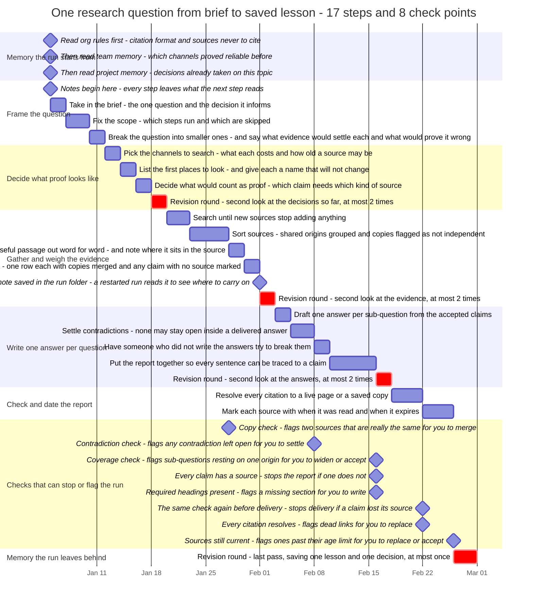

> Tables live in `researches/aidlc-deep-research-gantt-tables` (lane table, span table, time-unit arithmetic, assumptions, laziness patterns).

> **Digest.** Holds the Mermaid Gantt (17 steps, 8 check points, days counted in calls), the reader test, and the five disclosure gaps g1-g5.
> It is a PROPOSAL schedule over mem:researches/aidlc-deep-research-design: 8 lanes, 33 rows, loops as real rows, dates synthetic.
> Tables half - lane table, span table, time-unit arithmetic, assumptions, laziness patterns - lives in `researches/aidlc-deep-research-gantt-tables`.
> Read the reader test before quoting any date; the gaps list what the schedule invents.

# Gantt - one research question from brief to saved lesson (PROPOSAL schedule)

## The diagram

## Reader test - what a stranger must be able to say

| Question | Answer the chart gives | Where it is answered |
|---|---|---|
| (a) What happens first, and why? | Three memory reads before any search, because the team's channel history and the project's earlier decisions decide where to look | First lane, all three rows |
| (b) What does deciding what proof looks like buy? | It fixes, before searching, which claim needs which kind of source, so search can stop when new sources dry up instead of when the searcher tires | Third row of the proof lane, then the search row after it |
| (c) How many answers get written, and from what? | One per sub-question - the brief allows at most five - each sentence tied to a claim in the one claim list | The smaller-questions row and the draft row |
| (d) Where is memory read, and where saved? | Read before anything else; the note marker opens the work, the resume marker sits where evidence closes, and the last revision saves | Lanes 1, 2, 4 and 8 |
| (e) Which check can stop the run? | One check, fired twice: before the report and before delivery | Checks lane, the two rows that say stops |
| How long, and what is expensive? | 55 days; putting the report together (6d) and sorting sources (5d) are the longest bars | Bar lengths against the axis |
| What repeats, and how often? | A revision round after three boundaries, at most twice each, and one last revision at the end | The four red rows, each labelled revision round |
| Which numbers are invented? | All durations, and the 2-round and 1-lesson caps are the design's; see g1-g5 | This document, not the chart |

## Gaps disclosed (a schedule invents what the design omits)

- g1 no inputs: the design declares outputs and exits only. Every dependency above is inferred from the previous row's output; the only edges it names are channel history into the channel choice and the recorded locator into citation resolution.
- g2 no durations: every day count comes from the call formula, not measurement. Change the formula and all 33 rows move; the order does not.
- g3 loop ranges unstated: the caps (3 per step, 2 per boundary, 1 per run) are the design's; one day per round is the schedule author's, which is why each revision round is 2d and the closing revision is 3d. The per-step three rounds are inside each step's own days, so they get no row.
- g4 check order unstated: three checks fire on the report row at one instant; the chart is honest about simultaneity but cannot show order or conjunction.
- g5 scope membership: the design proposes scopes of 6, 11, 17 and 7 steps without listing them and never places its skip marks. Only the deep scope is drawn; a smaller scope would delete rows, not compress them.
