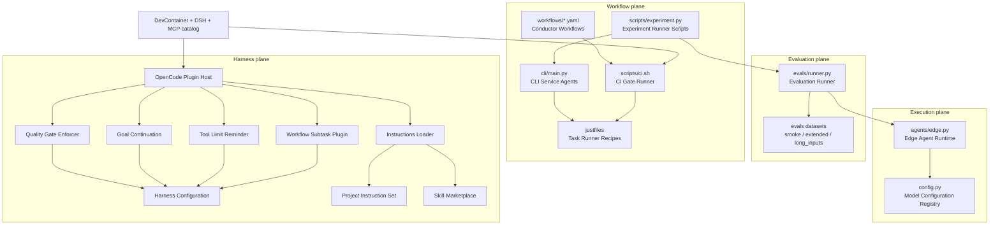
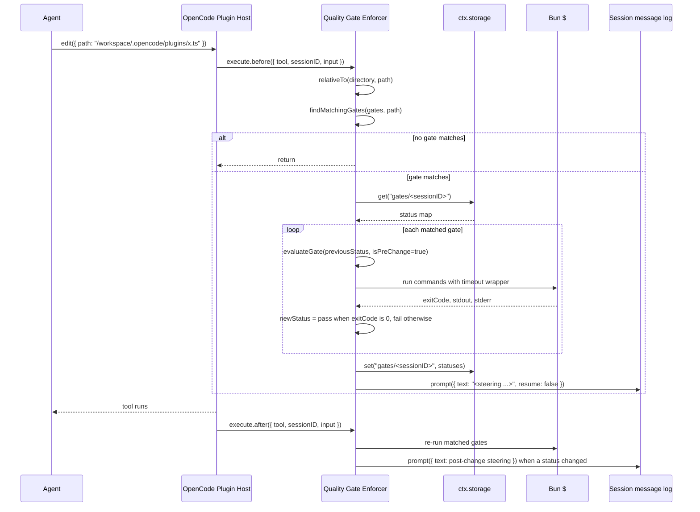
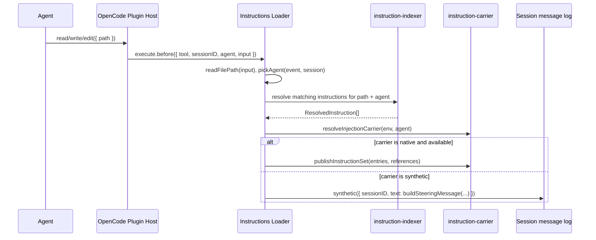
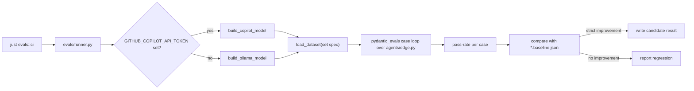
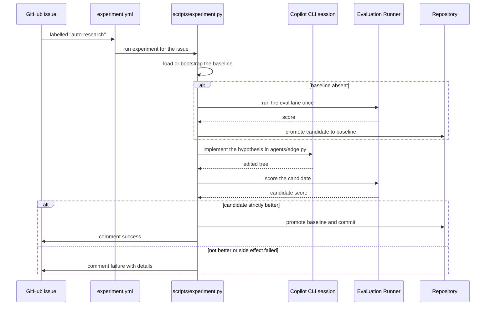
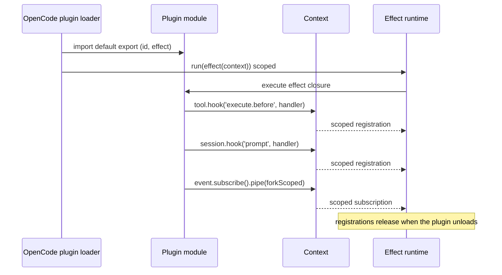

# Architecture

## Architecture Analysis

### System Overview

The repository is one product assembled from four cooperating planes:

- **Execution plane (harness-free).** `agents/edge.py` builds a pydantic-ai `Agent`, attaches three inline tools, and returns a typed `AgentOutput`. `config.py` resolves a model alias to a concrete pydantic-ai model and settings.
- **Evaluation plane.** `evals/runner.py` picks a provider, resolves a dataset, runs the agent over it with `pydantic_evals`, scores the cases, and writes a result file that is compared against a baseline.
- **Workflow plane.** CI (`.github/workflows/ci.yml` → `scripts/ci.sh` → `just` recipes), the experiment loops (`scripts/experiment.py`, `cli/`), and Conductor YAML workflows (`workflows/`) drive everything that is not a single agent call.
- **Harness plane.** OpenCode v2 plugins (`.opencode/plugins/`), the DeepSeek Harness template (`.dsh/`), Copilot custom agents (`.github/agents/`), the instruction corpus (`.opencode/instructions/`), and the skill marketplace (`.agents/skills/`).

### Architectural Style

**Modular monolith with plugin-based control planes.** Evidence:

- One Python distribution (`pyproject.toml:5-18`) with three importable packages at the repository root — `agents`, `evals`, `cli` — and no `src/` layout (a recorded project rule).
- One TypeScript package (`.opencode/package.json`) whose loader scans only root `.opencode/plugins/*.ts`, so each plugin is an independently loaded module with its own `effect` closure.
- Control-plane configuration is declarative and per-harness (`.dsh/*.yml`, `.github/agents/*.md`, `.opencode/plugins/config/harness.config.ts`), not shared code.
- There is no server, database, or message broker. Persistence is files: JSON state (`experiments/`), JSON baselines, and `context.storage` inside OpenCode sessions.

### Component Relationships

Text fallback: `config.py` supplies models to `agents/edge.py`; `evals/runner.py` drives the edge agent over bundled datasets; `scripts/experiment.py` and the Click CLI invoke the runner and the `just` recipes; `scripts/ci.sh` runs the `just` gate sequence; Conductor workflows invoke CI-shaped commands. In the harness plane the OpenCode plugin host loads five plugins — Quality Gate Enforcer, Instructions Loader, Goal Continuation, Tool Limit Reminder, and Workflow Subtask Plugin — all of which read sections from `harness.config.ts`. The Instructions Loader reads the project instruction corpus and the skill marketplace. The DevContainer, the DSH template, and the MCP catalog supply the environment to both CI and the plugin host.

### Data Flow

1. **Agent run.** `resolve_model_config(alias)` → `OpenAIChatModel` → `Agent.run(prompt)` → `AgentOutput` → printed result plus an OTLP trace.
2. **Eval run.** CLI arguments → provider selection (Copilot token present, else Ollama) → dataset resolution → `pydantic_evals` case loop → per-case scores → baseline comparison → result JSON.
3. **Experiment run.** GitHub issue label → workflow → baseline bootstrap if absent → Copilot session edits `agents/edge.py` → eval lane → strict-improvement check → promotion commit or failure comment.
4. **Quality-gate signal.** Tool event (`edit`/`write`) → absolute path → workspace-relative path → pattern match against configured gates → gate commands executed in a shell → status diff against the session map → formatted `<steering>` text → message appended to the session.
5. **Instruction delivery.** File touch → instruction index lookup → entry published to native storage → either a native carrier or a synthetic append, at most once per path per session.

### Key Design Decisions

- **Harness-free execution is separate from harness configuration.** System A (`agents/`, `config.py`) never reads `.dsh/` or `.opencode/` configuration; System B never edits `agents/`. This keeps the agent runnable in a plain Python process and the harness replaceable.
- **A single agent file over a framework.** `agents/edge.py` holds tools inline because edge models need a small, legible tool surface, and because a one-file agent is what the experiment loop can safely rewrite.
- **Fail-closed threshold pinning as gate 0.** `scripts/verify_thresholds.sh` reads the real config files and fails on a missing or lowered value, so a weakened gate cannot reach `main` without a committed, reviewed config change.
- **Per-harness config as code.** `harness.config.ts` is keyed by plugin id and lives in a subdirectory so the loader does not treat it as a plugin. Each plugin reads only its own section.
- **Synthetic append over prompt injection.** The OpenCode v2 API separates `session.prompt` (starts a turn) from `session.synthetic` (appends a message). Steering text that is not a human utterance belongs on the synthetic carrier.
- **Explicit state ownership.** Two experiment stores exist because two runners own them; merging them would have made one runner's crash corrupt the other's history.

### Improvement Opportunities

- **Signal delivery is inconsistent.** Quality Gate Enforcer reports through `session.prompt` while every other signalling plugin uses `session.synthetic`; unifying them removes a special case from the carrier contract.
- **Helper duplication across plugins.** Path extraction, shell quoting, template-array construction, glob matching, and the idle-event predicate each exist twice.
- **Dead production surface.** A debounce batcher, a single-gate formatter, a `debounceMs` setting, and two status types are tested but unused.
- **Serial gate execution.** Matched gates run one after another, so a file matching three gates waits for all three.
- **Python has no coverage floor.** The TypeScript side is pinned at 90% while Python coverage is neither collected nor gated.

## Interaction Diagrams

### Quality gate signal on a file edit

Text fallback: the host fires `execute.before` for `edit`/`write`. The plugin converts the absolute path to workspace-relative, selects matching gates, reads the per-session status map from `ctx.storage`, and (only on the pre-change pass) skips a gate whose status is already known. Each remaining gate runs its commands through Bun `$` with an optional hard `timeout` wrapper plus an in-process race, and the exit code becomes `pass` or `fail`. The status map is written back and any status transition is formatted as `<steering>` text and delivered with `session.prompt({ resume: false })`. After the tool completes, `execute.after` re-runs the same gates and delivers a second steering message when a status changed.

### Instruction delivery on a file touch

Text fallback: on each targeted tool event the loader extracts the path and agent, asks the indexer which instruction files match, then resolves a carrier. Native delivery publishes entries to session storage for the next request boundary; synthetic delivery appends a `<steering …>` block exactly once per path per session, guarded by a token in the same storage.

### Evaluation run against a baseline

Text fallback: the recipe invokes the runner, which selects a provider from the environment, resolves a dataset spec, runs the edge agent over every case, aggregates a pass rate, and compares it with the baseline file for that baseline id. A strictly better candidate is written for promotion; anything else is reported as a non-improvement.

### Experiment promotion

Text fallback: the workflow reacts to the label, asks the script runner to load or bootstrap a baseline, hands the hypothesis to a Copilot session that edits `agents/edge.py`, re-scores the candidate, and lets the workflow promote and commit only on strict improvement. Any other outcome is reported as a comment on the issue.

### Plugin registration

Text fallback: the loader imports each root `*.ts` module, reads its default export, and runs `effect(context)` inside a scope. Every registration the closure makes — tool hooks, session hooks, event subscriptions, and added tools — is released when the plugin unloads, which is why a v2 plugin has no `dispose` key.
