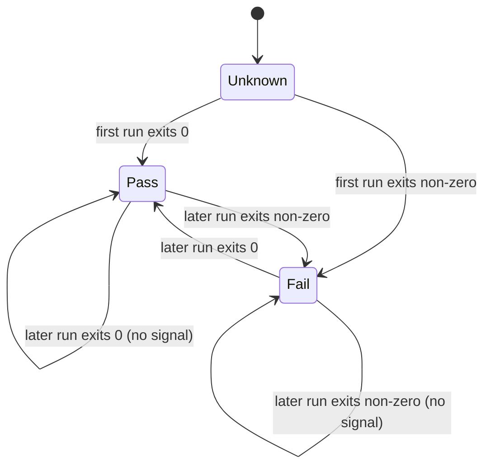
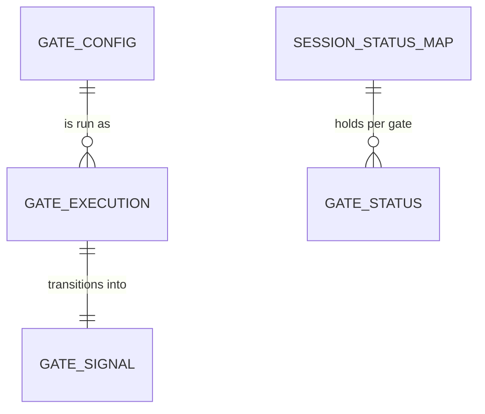

# Functional Specification

## Scope

This specification covers the quality-gate-enforcer plugin's signal path and the shared helper modules it uses. It is technology-agnostic about storage and transport beyond the two carriers the host exposes, and it fixes the ordered behaviour that `entities.md` (data shape) and `rules.md` (decision logic) do not.

## Workflow WF1 — Pre-change evaluation

Trigger: the host fires the pre-change tool hook for `edit` or `write`.

1. Read the file path from the tool input (BR3.1). If no path, stop.
2. Convert the path to workspace-relative (BR3.2).
3. Select the gates whose patterns match (BR3.4 shape: `patterns` any-match).
4. If no gate matches, stop.
5. Read the session's gate status map. A missing map means every gate is `unknown`.
6. For each matched gate in configuration order:
   1. If the map already holds a status for the gate, skip it (BR2.2).
   2. Otherwise run the gate's commands and derive `pass` or `fail` from the exit code.
   3. Compare with `unknown`; a result always differs, so it is a transition.
7. Write the updated map back to session storage.
8. If any transition occurred, append one synthetic signal (BR1.1, BR2.1).
9. A failed append is logged and does not stop the hook (BR5.1).

## Workflow WF2 — Post-change evaluation

Trigger: the host fires the post-change tool hook for `edit` or `write`.

1. Read and convert the path exactly as WF1 steps 1–2.
2. Select matching gates; stop when none match.
3. Read the session's gate status map.
4. For each matched gate in configuration order:
   1. Run the gate's commands (BR2.3 — no skipping here).
   2. Compare the result with the map's status (or `unknown`).
   3. Record the new status and, when it differs, collect a transition.
5. Write the updated map back.
6. If any transitions were collected, append one synthetic signal (BR1.1).
7. A failed append is logged and does not stop the hook (BR5.1).

The two hooks share steps 1–3 and the map read; they differ only in the skip rule and in whether an unknown status counts as a transition.

## Workflow WF3 — Signal rendering

1. Partition the transitions into passing and failing counts.
2. Choose attributes: `priority` is `warning` when any gate fails and `info` otherwise; `result` is `fail` or `pass` to match; `reason` names the pre-change or post-change pass.
3. Build the body: a header line naming the counts, then one line per transition with the check mark, gate name, previous status, new status, first command, and exit code. Append the combined output only for a failing gate.
4. Wrap the body with the shared builder and append it as one synthetic message, with the gate name and transition in metadata and no message id (BR6.1).

## Workflow WF4 — Shared helper resolution

1. The path helper exports one function that reads a tool input and yields a path or nothing.
2. The path helper exports one function that strips the workspace prefix.
3. The steering helper exports one builder that accepts attributes and a body, defaulting to the instruction attributes.
4. `instruction-payload.ts` re-exports the builder so its existing call site keeps working.
5. The gate formatter calls the same builder with gate attributes.

## State machine — gate status in one session



Text fallback: a gate starts at `unknown` in a session. Its first completed run moves it to `pass` or `fail` and emits one signal. A later run that keeps the same status emits nothing. A later run that flips the status emits one signal. The map is per session and is discarded when the session ends.

## Shared helper contracts

```ts
export interface ToolInputLike { path?: unknown; filePath?: unknown }
export const readFilePath = (input: unknown): string | undefined => { /* ... */ }
export const relativeTo = (directory: string, filePath: string): string => { /* ... */ }

export interface SteeringAttributes {
  priority: 'info' | 'warning' | 'high'
  reason: string
  type: 'instructions' | 'quality-gate' | 'todo'
  result?: 'pass' | 'fail'
  gateId?: string
}
export const buildSteeringMessage = (
  attributes: SteeringAttributes,
  body: string,
): string => { /* ... */ }
```

The snippets are interface-level only; bodies belong to code generation.

## Derived entity-relationship view



Text fallback: one gate configuration backs many executions; a session status map holds one status per gate; each execution that changes a status produces exactly one signal. `entities.md` is the source of truth for these shapes.

## Derived rules summary

| Rule | Effect on behaviour |
|------|---------------------|
| BR1.1, BR2.1 | One synthetic signal per status transition |
| BR1.2 | No prompt call on the signal path |
| BR1.3 | Steering shape, command and exit code preserved; output only on failure |
| BR2.2, BR2.3 | Pre-change skips known gates; post-change checks every match |
| BR3.1, BR3.2 | Path extraction and workspace-relative matching |
| BR3.3, BR3.4 | One steering builder, imported by both entry points |
| BR4.1 | Dead surface removed with its tests and keys |
| BR5.1 | Append failure warns and continues |
| BR6.1 | Metadata carries gate and transition, no id |
| BR6.2 | Plugin id and gates key unchanged |

`rules.md` is the source of truth for the rules themselves.

## Error handling

- **No path in the tool input**: the hook returns without work, as today.
- **No matching gate**: the hook returns without work.
- **Gate command throws**: the existing runner settles the execution with a non-zero result; the status becomes `fail`.
- **Synthetic append fails**: log a warning naming the failure; the tool call continues (BR5.1).
- **Storage read fails**: treat the map as empty (all `unknown`) and continue; the next write replaces it.
- **Configuration missing or malformed**: the existing loader behaviour stands; this design adds no new failure mode.
